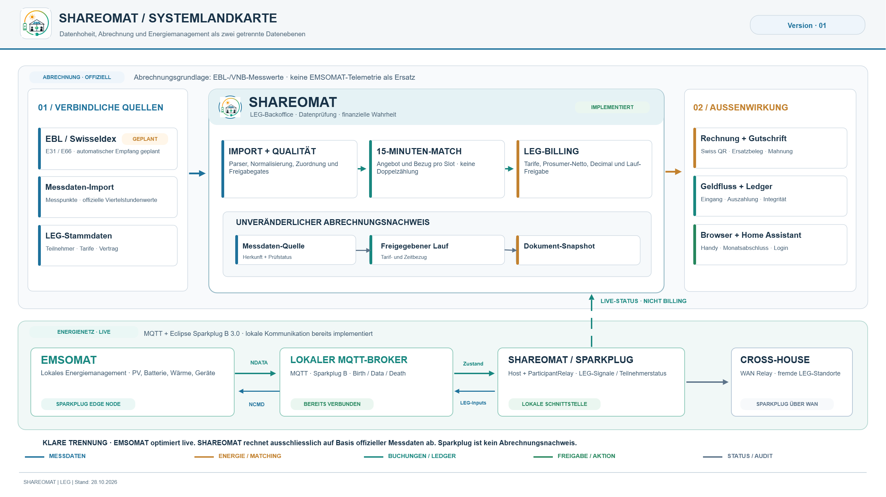

# Shareomat

> **🚧 Work in Progress — under active development, not production-ready.**

Hallo

Dieses Repository ist mein Versuch, ein einfaches und nachvollziehbares Abrechnungssystem für Schweizer LEG- und ZEV-Gemeinschaften zu entwickeln.

Die Idee entstand, weil ich bisher keine wirklich schlanke Lösung gefunden habe, die sich auf das Wesentliche konzentriert: Messdaten des Netzbetreibers möglichst automatisch zu importieren, den Verbrauch der LEG-Gemeinschaft korrekt zwischen lokal erzeugter Energie und Netzbezug aufzuteilen und daraus nachvollziehbare Abrechnungen zu erstellen.

Aktuell befindet sich das Projekt noch im Aufbau und ist weit von einer produktiven Version entfernt. Ich entwickle es hauptsächlich nebenbei an Wochenenden und in meiner Freizeit. Entsprechend wird sich noch einiges ändern.

Das langfristige Ziel ist es, eine Lösung zu schaffen, mit der kleinere LEG- oder ZEV-Gemeinschaften ihre Energieabrechnung mit möglichst wenig manuellem Aufwand durchführen können – idealerweise ohne teure Spezialsoftware.

**Shareomat läuft als Home-Assistant-Add-on oder komplett eigenständig, ganz
ohne Home Assistant** — dieselbe Kernanwendung (Weboberfläche, SQLite-
Datenbank, Abrechnungslogik) in beiden Fällen. Getestet habe ich bisher
primär den Weg als HA-Add-on (siehe Quick Start unten); der eigenständige
Weg per Docker Compose oder nativ mit Python sollte genauso funktionieren,
ist aber noch nicht im gleichen Umfang durchgespielt — es gibt dort einen
echten, bisher ungetesteten Code-Pfad (kein Ingress-Pfad-Präfix, siehe
"Standalone" weiter unten). Feedback dazu ist besonders willkommen.

## Architektur



Shareomat rechnet ausschliesslich mit offiziellen Messdaten des Netzbetreibers
ab. Die lokale Sparkplug-Verbindung zu EMSOMAT liefert nur Live-Status und ist
kein Abrechnungsnachweis.

Ausführliche Beschreibung: [`docs/ARCHITECTURE.md`](docs/ARCHITECTURE.md).

---

## Quick start (Home Assistant add-on)

1. In Home Assistant: **Settings → Add-ons → Add-on Store**
2. Add this repository as a custom repository:
   `https://github.com/bobis-code/shareomat`
3. Install **Shareomat**, configure MQTT/e-mail if wanted, start it.
4. Set up the login (see **Erstes Login** below).
5. Open it from the sidebar (Ingress panel) and complete the setup wizard
   (Gemeinschaft → Teilnehmer → Messpunkte → Vertrag).

Gemeinschaft, Teilnehmer, Messpunkte, Vertrag, and automation settings are
managed entirely through this web interface — not through `leg_config.yaml`
— and are stored in a SQLite database. Add-on options cover only technical
runtime settings (MQTT, e-mail import).

Prices are set on the **Vertrag** page, not the Tarife page: publishing a
contract version there creates the tariff that governs billing for its
validity period, with the notice periods from the LEG-Mustervertrag enforced
before publishing. The Tarife page still exists, but only as a manual
fallback for first-time setup or emergencies — see its own warning banner.

Once set up, drop CSV or S-DAT files into the inbox (or upload them through
the "Messdaten" page) and trigger a run from the web interface. Reports are
written to the reports folder; processed files move to the archive.

The canonical Python source lives in `shareomat/` and `main.py`. The
`ha_addon/` directory contains a synced build copy so Home Assistant can
build the add-on from `ha_addon/` as its Docker context — it is not a
separate codebase, just a mirror. There is no automatic hook: after changing
application code, refresh the add-on copy before committing:

```bash
./prepare_addon.sh
```

To verify that the add-on copy is current:

```bash
python tools/prepare_addon.py --check
```

### Erstes Login (ab Version 0.6.0)

Shareomat ist mit einem Passwort geschützt, weil darin Rechnungen, Bankdaten
und Adressen stehen. Es gibt ein Administrator-Konto, das mehrere Personen
gemeinsam verwenden können.

1. Add-on starten und in Home Assistant unter **Einstellungen → Add-ons →
   Shareomat → Protokoll** die Zeile suchen:

   ```text
   Shareomat Ersteinrichtung: Einmal-Code  ABCD-EFGH-JKLM  (gültig bis … UTC)
   ```

   Der Code gilt einmal und höchstens 24 Stunden. Nach einem Neustart steht
   ein neuer Code im Protokoll, solange noch kein Zugang eingerichtet ist.
2. Shareomat öffnen. Es erscheint **«Willkommen – Zugang einrichten»**.
3. Code eintragen, Benutzername wählen (z. B. `admin`) und ein Passwort mit
   **mindestens 12 Zeichen** zweimal eingeben. Am einfachsten ist ein Satz,
   z. B. «Sonne scheint auf unser Dach 2026».
4. Auf dem eigenen Handy **«Auf diesem Gerät 30 Tage angemeldet bleiben»**
   ankreuzen. Ohne Häkchen endet die Anmeldung nach 30 Minuten ohne
   Benutzung oder spätestens nach 12 Stunden.
5. Weitere Handys melden sich mit demselben Benutzernamen und Passwort an.

| Problem | Lösung |
|---|---|
| Einmal-Code «ungültig oder abgelaufen» | Den neuesten Code aus dem Protokoll nehmen, bei Bedarf Add-on neu starten. |
| «Zu viele Fehlversuche von diesem Gerät» | 15 Minuten warten oder ein anderes Gerät nehmen. Das Konto selbst wird nie gesperrt. |
| Passwort vergessen | Add-on → **Konfiguration** → `reset_login` einschalten → Add-on neu starten → neuen Code aus dem Protokoll verwenden und neues Passwort festlegen → `reset_login` wieder ausschalten. |
| Handy verloren | Auf einem anderen Gerät **Mein Konto → «Alle anderen Geräte abmelden»**, danach Passwort ändern. |

Hinweis: Innerhalb von Home Assistant fragt Shareomat in dieser Version
zusätzlich nach dem eigenen Passwort (mit «angemeldet bleiben» nur alle 30
Tage). Zugang aus dem Internet nur über HTTPS (z. B. Nabu Casa, Tailscale),
Shareomat nie direkt freigeben.

Ausführlich: [`docs/Erstes_Login.md`](docs/Erstes_Login.md) (Schritt für
Schritt mit Live-Test) und [`docs/Anleitung_Zugang.md`](docs/Anleitung_Zugang.md)
(Bedienung und Technik).

### Rechnungen & Gutschriften

Nach einer freigegebenen Monatsabrechnung führt die Übersicht
(**Monatsabschluss**) durch die nächsten Schritte: Bankkonto einmalig
einrichten → Belege prüfen und freigeben → drucken bzw. versenden
(Sammeldruck) → Zahlungseingänge erfassen → Produzenten auszahlen (nur so
weit Zahlungen eingegangen sind). Rechnungen enthalten einen Schweizer
QR-Zahlteil. Mahnungen werden ab 5 Tagen nach Fälligkeit vorgeschlagen.
E-Mail-Versand (SMTP) und Bankdatei-Import folgen später.

## Input formats

### CSV

```
timestamp,meter_id,value_kwh,direction[,quality]
2024-06-01T12:00:00+00:00,CH001...,0.125,export
2024-06-01T12:00:00+00:00,CH002...,0.080,import
```

`quality` defaults to `valid`. Use `invalid` to exclude a reading. Older files
with the column name `mpid` instead of `meter_id` are still accepted.

### S-DAT XML

Standard Swiss S-DAT metering data exchange format. Both namespaced (`xmlns="http://www.strom.ch/sdat/MeteringData"`) and plain variants are accepted.

## External data sources

Beyond importing meter readings, the "Externe Daten" page pulls in official
Swiss reference data on demand — no API key needed except where noted:

| Source | What it fetches | Used for |
|---|---|---|
| **ElCom** (LINDAS SPARQL, `energy.ld.admin.ch/elcom`) | Grid operator lookup and official tariff components per municipality/category | Comparing/sanity-checking local tariffs |
| **BFE** (opendata.swiss, "Referenz-Marktpreise gemäss Art. 15 EnFV") | Official quarterly/monthly PV reference market price | The authoritative rate for final feed-in settlement |
| **SNB** (`data.snb.ch`) | EUR/CHF exchange rates | Converting EUR-denominated inputs (e.g. ENTSO-E) to CHF |
| **ENTSO-E** (Transparency Platform) | Swiss day-ahead prices and generation profiles — needs a free personal API token | A non-official price *forecast* for the dashboard/tariff planning only |

The BFE value is the only one of these used for actual settlement — ElCom,
SNB, and ENTSO-E feed a forecast/comparison view, never a billing run
directly. Every fetch is persisted (so results survive without re-fetching)
and logged in a recent-imports history on the same page.

## Configuration

Shareomat splits configuration into two places, deliberately:

- **`leg_config.yaml`** (technical runtime settings only) — paths, MQTT
  broker, e-mail import, web server port. For the add-on this is generated
  from the add-on options; for standalone use, copy
  `config/leg_config.example.yaml` to `config/leg_config.yaml` and edit the
  local file. It is intentionally ignored by Git because it may contain
  broker addresses and MQTT/IMAP credentials.
- **The admin web interface** (backed by `data/shareomat.db`) —
  Gemeinschaft, Teilnehmer, Messpunkte, Vertrag (which governs Tarife), and
  automation settings. This is the data that actually changes as a LEG/ZEV
  community grows, so it is managed live in the UI instead of a config file
  that requires a restart.

| `leg_config.yaml` key | Description |
|-----|-------------|
| `paths.inbox` / `archive` / `reports` / `state` | Runtime filesystem paths |
| `paths.share_inbox` | External share folder to watch for meter files; empty = disabled |
| `mqtt.enabled` / `broker` / `port` | Optional — publish status/prices/tariffs as MQTT topics (with Home Assistant MQTT Discovery) for Home Assistant or any other MQTT-aware system. Off by default; Shareomat runs fully without it. |
| `email.enabled` | Poll an IMAP mailbox (e.g. a dedicated Gmail account) for meter-data attachments |
| `email.allowed_senders` | Only accept attachments from these sender addresses; empty = accept any sender |
| `web.enabled` / `port` | Admin web interface — always available; standalone (`http://localhost:8099`) or, if run as the HA add-on, also behind Home Assistant Ingress |

Never commit real passwords or private MQTT/email credentials. Use the Home
Assistant add-on options for add-on deployments, or keep local credentials
only in the ignored `config/leg_config.yaml`. For Gmail, use an App Password
(requires 2-Step Verification), never the account password.

Upgrading from a version where `leg_config.yaml` still contained
`participants`/`meters`/`tariffs`/`leg`? Those sections are imported into
`data/shareomat.db` automatically, once, the first time you start the new
version — after that, the database is authoritative and those YAML sections
are ignored.

## Matching algorithm

For each 15-minute slot, local energy is shared **pro rata with the same key for every
participant** — the rule of Art. 19g StromVV as described in VSE BD LEG-CH 2025 Kap. 2 (11) and 6.1, i.e. exactly
what the grid operator delivers as SDAT E66 `LEGE`/`LEGR`.

### Formula

```
P = Σ export_i            (all exports in the slot)
C = Σ import_j            (all imports in the slot)
L = min(P, C)             (energy shared inside the LEG)

local_received_j = import_j × L / C      grid_import_j = import_j − local_received_j
local_supplied_i = export_i × L / P      grid_export_i = export_i − local_supplied_i
```

There is **no self-exclusion**: a prosumer meter may import and export in the same slot (import
and export are not netted within a quarter hour, VSE Kap. 5 (1)) and receives the same share of
its import as everyone else. Excluding its own export would diverge from the grid operator's
allocation — and therefore from the grid operator's invoice, which bills energy only on `LEGR`.

For the energy ledger report, a clearing matrix shows who "sold" to whom on paper:

```
flow[i → j] = local_supplied_i × import_j / C
```

Rows sum to `local_supplied_i`, columns to `local_received_j`. For a prosumer the matrix can
contain `flow[i → i]`; that is an accounting split, not a physical flow.

### Worked example

```
Slot 12:00

Meter 1:  export 5 kWh,  import 5 kWh   (prosumer)
Meter 2:  export 3 kWh,  import 1 kWh   (prosumer)
Meter 3:  export 0 kWh,  import 20 kWh  (consumer)

P = 8 kWh, C = 26 kWh, L = 8 kWh
```

```
Meter 1:  local_received = 5  × 8/26 = 1.538 kWh,  grid_import =  3.462 kWh
Meter 2:  local_received = 1  × 8/26 = 0.308 kWh,  grid_import =  0.692 kWh
Meter 3:  local_received = 20 × 8/26 = 6.154 kWh,  grid_import = 13.846 kWh

Meter 1:  local_supplied = 5 × 8/8 = 5 kWh,  grid_export = 0
Meter 2:  local_supplied = 3 × 8/8 = 3 kWh,  grid_export = 0
```

When the grid operator's E66 time series are available they are authoritative for invoices;
this algorithm reproduces them and is used for simulation and validation.

## Running tests

```bash
pip install -r requirements-dev.txt
pytest tests/
```

(`requirements-dev.txt` pulls in `requirements.txt` plus `pytest` — plain
`requirements.txt` alone does not include a test runner.)

## Standalone (without Home Assistant)

> **Not yet tested end-to-end by me** — the code path differs from the HA
> add-on in one concrete way (no `X-Ingress-Path` header, so URL generation
> takes the "no prefix" branch instead — see `shareomat/web/navigation.py`).
> It should work, since it's the same core application, but I have only
> verified the HA add-on path live so far. Reports welcome either way.

```bash
git clone https://github.com/bobis-code/shareomat.git
cd shareomat
cp config/leg_config.example.yaml config/leg_config.yaml

docker compose up --build
```

Open the web interface at `http://localhost:8099`. The one-time setup code
for the first login is printed in the container log
(`docker compose logs shareomat | grep Einmal-Code`); then complete the same
setup wizard as above (Gemeinschaft → Teilnehmer → Messpunkte → Vertrag).
Docker binds the port to `127.0.0.1` only — put an HTTPS reverse proxy in
front for access from other devices.

For a more detailed walkthrough (including a native Python setup without
Docker, sample test data, and troubleshooting), see
[`docs/local-setup.md`](docs/local-setup.md).

## Related: Emsomat (optional)

Shareomat can optionally exchange data with
[Emsomat](https://github.com/bobis-code/Emsomat), a separate Home Assistant
integration for local battery/heat-pump/EV optimization, over the local MQTT
broker using **Eclipse Sparkplug B** (ADR-0004, ADR-0006). Shareomat sends
LEG prices and a demand forecast (`LEG/ExportPrice`, `LEG/FeedInPrice`,
`LEG/DemandForecast`); Emsomat confirms what it took over. This is live
information only — billing never uses it. Contract:
[`docs/Architektur/Emsomat_Shareomat_MQTT_Vertrag.md`](docs/Architektur/Emsomat_Shareomat_MQTT_Vertrag.md).

Neither project requires the other. Note: unlike Shareomat, Emsomat is a
Home Assistant *integration* and is installed via HACS, not the Add-on
Store — see its own README.

## Project layout

Full architecture writeup (layers, runtime scenarios, deployment, known
risks, glossary): [`docs/ARCHITECTURE.md`](docs/ARCHITECTURE.md).

```
shareomat/                    Python package
  leg_const.py               Domain constants
  config.py                  Technical runtime config (paths/MQTT/e-mail/web) + LegConfig + validation
  core/
    leg_runner.py            Pipeline orchestration — run(config: LegConfig)
    collector/                Data intake
      leg_import.py            Inbox scan & archive
      leg_email_importer.py    IMAP mailbox → inbox importer
      leg_scheduler.py         Cron-based run scheduler
      leg_watcher.py           Inbox file watcher
      leg_share_importer.py    Share folder → inbox importer
      leg_storage.py           Processed-file state (SHA-256 dedup)
    pipeline/                  Settlement processing
      leg_parser.py            CSV / S-DAT / XLSX parser
      leg_normalizer.py        Reading normalization
      leg_matcher.py           Proportional energy sharing
      leg_billing.py           Period aggregation & cost calculation
      raw/
        ebl_xlsx.py            EBL Excel format parser
        sdat_ch.py             SDAT-CH (E31/E66) parser — raises until the real structure is verified
    report/
      leg_report.py            CSV + JSON report writers
    payments/
      swiss_qr.py              Swiss QR bill payload + payment part
  database/                   SQLite admin database (source of truth for master data)
    sqlite.py                  Connection, schema, migrations
    community.py / participants.py / meters.py / tariffs.py / settings.py
    contract_versions.py       Versioned LEG contract terms — draft/publish/withdraw/end,
                                the source of truth for tariffs (see models/contract.py)
    contract_settings.py       Prefill defaults for a brand-new contract draft
    participant_contract.py    Which contract version/tariff a participant accepted
    config_builder.py          Combines RuntimeConfig + database into a LegConfig
    yaml_import.py             One-time import of a pre-existing leg_config.yaml
    invoicing.py               Invoices/credit notes, payments, payouts, reminders, cancellations
    auth.py                    Users, sessions, one-time setup code, throttling
    audit.py                   Audit log (who did what)
  security/                   Password hashing (Argon2id), request principal, permissions/roles
  models/                     Domain dataclasses
    community.py / participant.py / meter.py / tariff.py / settings.py
    contract.py                  ContractVersion / ContractSettings
    meter_data.py               IntervalReading / EnergySlot / ImportFile
    billing.py                  MatchResult / BillingRecord
    invoicing.py                Invoices, payments, payouts, payment profile
  web/                        Admin web interface (standalone or behind HA Ingress)
    server.py                  HTTP server, routing, upload/download, CSRF
    login.py                   Central login gate, cookies, client address
    state.py                   Shared engine <-> web state
    navigation.py               Sidebar structure + URL generation
    reports.py                  Report discovery/rendering helpers
    pages/                      One module per page (dashboard, participants, meters, ...)
    templates/                  Jinja2 templates
    static/                     app.css, banner.png
  external_data/              ElCom, BFE, EBL, market forecast (ENTSO-E/SNB) fetchers
  ha/
    mqtt_runtime.py          MQTT client lifecycle
    mqtt_discovery.py        Home Assistant MQTT Discovery
    entities/                HA entity definitions (sensors, buttons, numbers, switches)
  sparkplug/                  Sparkplug B: host, participant relay, WAN up/downlink (Emsomat, Cross-House)
ha_addon/                    Home Assistant Add-on
  config.yaml                 Add-on manifest (technical options only)
  Dockerfile                  Multi-arch container image
  run.sh                      Container entrypoint
  generate_runtime_config.py  options.json → technical leg_config.yaml
main.py                      Entry point
data/inbox/                  Drop input files here
data/archive/                Processed files land here
data/reports/                billing_*.csv/json, match_detail_*.csv
data/state/                  processed_files.json
data/shareomat.db            Admin database (Gemeinschaft/Teilnehmer/Messpunkte/Vertrag/Tarife)
```

## Lizenz

Shareomat steht derzeit unter einer **Closed-Beta-Lizenz**: Nutzung für eine
eigene Installation zu Test- und Evaluationszwecken, keine Weitergabe und
keine kommerzielle Nutzung ohne schriftliche Erlaubnis. Details:
[`LICENSE`](LICENSE). Versionen bis einschliesslich Commit `8fe12cb`
(06.09.2026) bleiben unter der MIT-Lizenz, siehe
[`LICENSE-MIT-HISTORICAL.md`](LICENSE-MIT-HISTORICAL.md).
